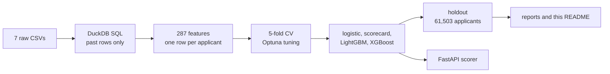
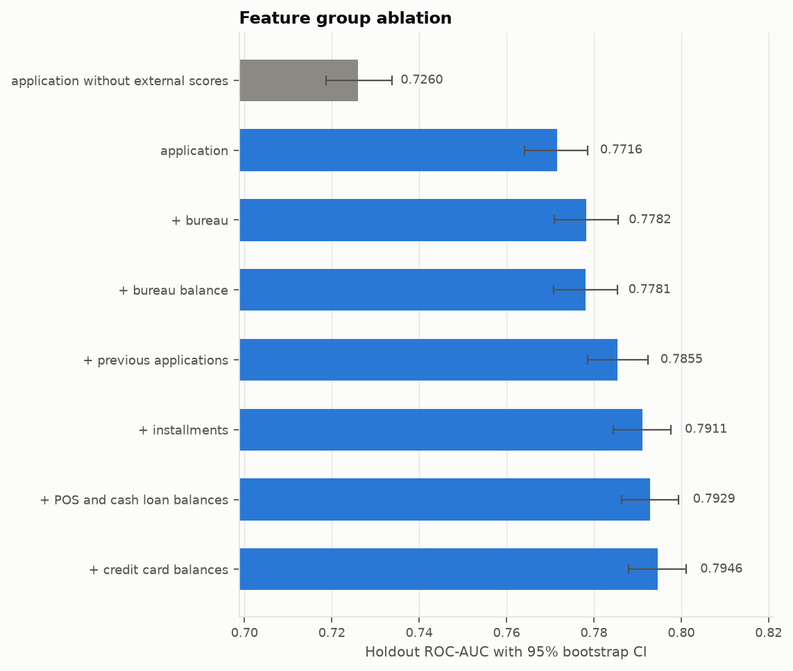
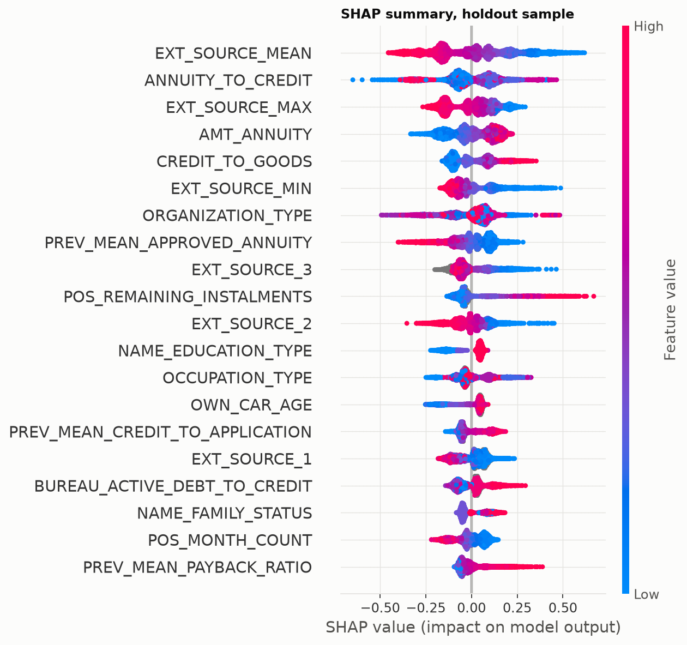
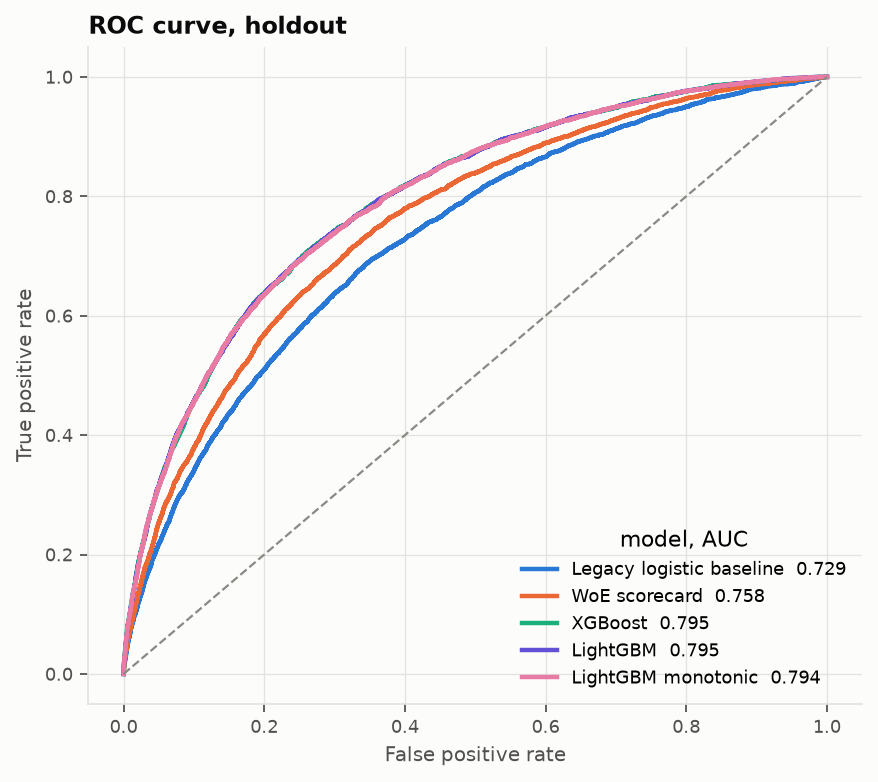
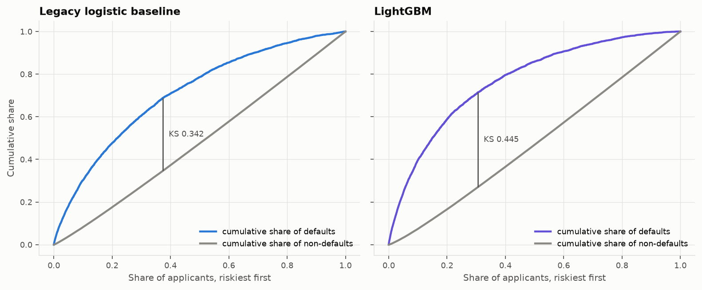
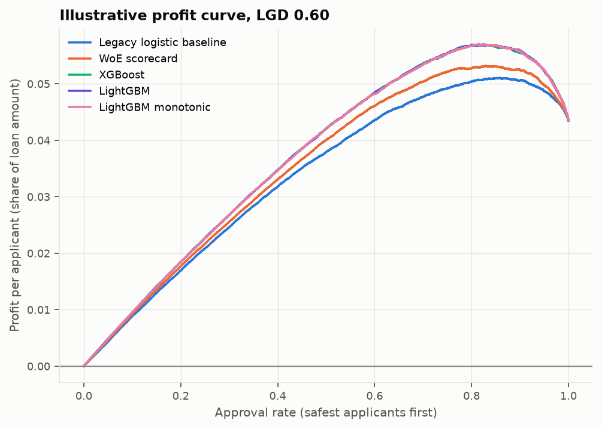
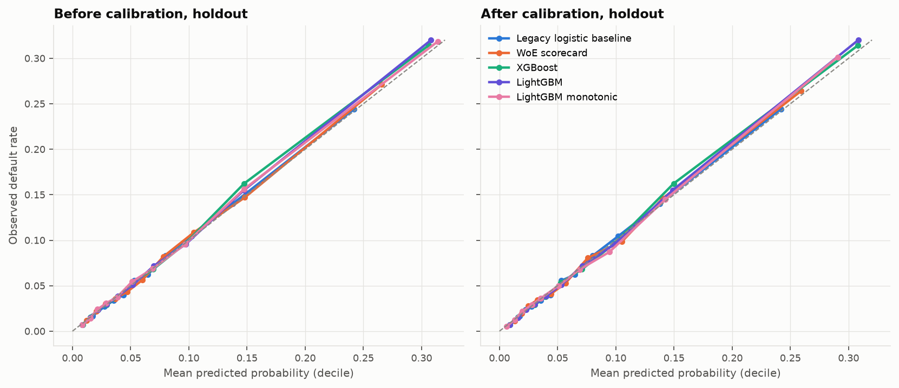

# home-credit-default-model

[](../../actions/workflows/ci.yml)   

Predicting which Home Credit applicants will have trouble repaying. 307,511 loans, 8.1% of them went bad, and all 7 tables from the Kaggle competition are used. Features are built in DuckDB SQL, only from records dated before each application, with tests that fail if anything from the future gets in.

**Jump to:** [results](#results) · [what each table adds](#what-each-table-adds) · [what drives the score](#what-drives-the-score) · [calibration](#calibration) · [fairness](#fairness-and-drift) · [scoring](#scoring) · [running it](#running-it)



## Results

On a 61,503 applicant holdout that was never used for tuning. AUC brackets are 95% bootstrap intervals.

| model | AUC | KS | Gini | PR-AUC | Brier | AUC gain vs old model |
|---|---|---|---|---|---|---|
| Legacy logistic baseline | 0.7288 [0.7209, 0.7364] | 0.3421 | 0.4575 | 0.2120 | 0.06939 |  |
| WoE scorecard | 0.7581 [0.7504, 0.7656] | 0.3896 | 0.5162 | 0.2388 | 0.06799 | +0.0293 |
| XGBoost | 0.7947 [0.7880, 0.8012] | 0.4465 | 0.5894 | 0.2993 | 0.06503 | +0.0660 |
| LightGBM | 0.7946 [0.7880, 0.8011] | 0.4449 | 0.5891 | 0.2996 | 0.06504 | +0.0659 |
| LightGBM monotonic | 0.7940 [0.7873, 0.8006] | 0.4437 | 0.5880 | 0.2984 | 0.06508 | +0.0653 |

- LightGBM beats the old logistic model by +0.0659 AUC [+0.0606, +0.0708]. Holding the bad rate at 5%, that means approving 86.9% of applicants instead of 76.3%.
- The scorecard is weaker (0.7581) but every point is readable, see [reports/scorecard.csv](reports/scorecard.csv).
- Forcing monotonic behaviour on 29 features costs only +0.0006 AUC, cheap for a model you have to defend.
- Class weighting didn't help: AUC moved -0.0029 and Brier went from 0.0656 to 0.1644 (it predicts a 36% average default rate when the real one is 8%).
- No feature scores above 0.75 AUC on its own, so nothing looked like a leak.

<details>
<summary>Approval rate at a fixed bad rate</summary>

| model | 3% bad rate | 5% bad rate | 8% bad rate |
|---|---|---|---|
| Legacy logistic baseline | 41.9% | 76.3% | 99.8% |
| WoE scorecard | 53.3% | 81.4% | 99.9% |
| XGBoost | 63.7% | 86.8% | 99.9% |
| LightGBM | 63.9% | 86.9% | 99.9% |
| LightGBM monotonic | 64.0% | 86.8% | 99.9% |

</details>

## What each table adds



The application table alone gets 0.7716, all 7 tables get 0.7946. Biggest single jump is previous applications (+0.0073), and bureau balance adds basically nothing (-0.0001, interval [-0.0008, +0.0006]). The three external bureau scores carry a lot: drop them and the application-only model falls to 0.7260. Full numbers with intervals are in [reports/ablation.md](reports/ablation.md).

## What drives the score



<details>
<summary>ROC, KS and cost curves</summary>







</details>

## Calibration



## Fairness and drift

One cut-off, set so the approved book has a 5% bad rate. Gender is not a model input. Approval rates mostly follow each group's real default rate. Score PSI between train and holdout is 0.0005, as expected for a random split.

<details>
<summary>By gender and age</summary>

| group | applicants | default rate | AUC | approved |
|---|---|---|---|---|
| F | 40,561 | 0.070 | 0.7900 | 88.8% |
| M | 20,940 | 0.102 | 0.7929 | 83.1% |
| under 30 | 8,905 | 0.113 | 0.7686 | 77.3% |
| 30-40 | 16,487 | 0.096 | 0.7991 | 82.5% |
| 40-50 | 15,303 | 0.076 | 0.8024 | 88.1% |
| 50-60 | 13,617 | 0.063 | 0.7810 | 92.4% |
| 60+ | 7,191 | 0.050 | 0.7499 | 95.7% |

</details>

## Scoring

```bash
make score ID=<SK_ID_CURR>
```

<details>
<summary>Example output for applicant 100009</summary>

```json
{
  "sk_id_curr": 100009,
  "model": "lightgbm",
  "in_holdout": true,
  "probability_of_default": 0.004604,
  "raw_model_probability": 0.004371,
  "scorecard_points": 620.1,
  "risk_band": "A",
  "reason_codes": [
    {
      "feature": "ANNUITY_TO_CREDIT",
      "value": 0.026463,
      "direction": "decreases risk",
      "contribution": -0.321203
    },
    {
      "feature": "DOCUMENT_COUNT",
      "value": 2.0,
      "direction": "decreases risk",
      "contribution": -0.280091
    },
    {
      "feature": "EXT_SOURCE_MEAN",
      "value": 0.663607,
      "direction": "decreases risk",
      "contribution": -0.200478
    },
    {
      "feature": "AMT_ANNUITY",
      "value": 41301.0,
      "direction": "increases risk",
      "contribution": 0.174802
    },
    {
      "feature": "OCCUPATION_TYPE",
      "value": "Accountants",
      "direction": "decreases risk",
      "contribution": -0.174623
    }
  ]
}
```

</details>

<details>
<summary>As an API or in Docker</summary>

```bash
make serve
curl localhost:8000/applicants/100009/score
curl -X POST localhost:8000/score -H 'content-type: application/json' -d '{"sk_id_curr": [100002, 100003]}'

make docker
docker run -p 8000:8000 -v $PWD/models:/app/models -v $PWD/data/processed:/app/data/processed credit-risk-lab
```

Swagger docs at `localhost:8000/docs`.

</details>

## Running it

Python 3.11 and a Kaggle token in `~/.kaggle/kaggle.json`.

```bash
make setup
make all
make test
```

`make all` goes from raw CSVs to this README. The full run tunes 40 trials per model and takes a few hours on a laptop, `make quick` does the same with a tiny budget and writes to `build/quick` instead. Settings are in `config.yaml`.

<details>
<summary>More results</summary>

- [model comparison](reports/model_comparison.md)
- [data quality](reports/data_quality.md)
- [feature build](reports/feature_build.md) and [leakage audit](reports/leakage_audit.md)
- [class imbalance](reports/imbalance.md)
- [explainability and PSI](reports/explainability.md)
- [fairness](reports/fairness.md)
- [scorecard points](reports/scorecard.csv)

</details>

## Caveats

- No real dates in the data, so this is a random holdout, not an out-of-time test. Expect it to do a bit worse on new loans.
- Only approved applicants are in the data, no reject inference.
- The cost curve uses made-up margin and loss numbers from `config.yaml`.
