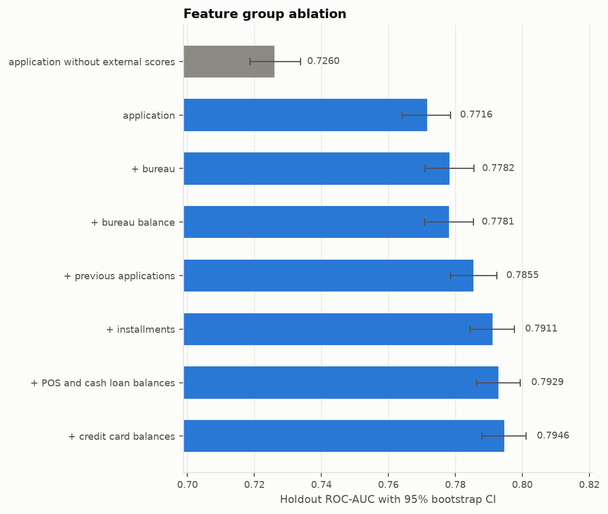

# Feature group ablation

Model: LightGBM with the tuned parameters, retrained with 5-fold CV on each feature set; holdout predictions average the fold models. Intervals come from 1000 paired bootstrap resamples of the holdout.

| feature set | features | CV AUC | holdout AUC [95% CI] | holdout KS [95% CI] | AUC gain over previous step [95% CI] |
|---|---|---|---|---|---|
| application without external scores | 130 | 0.7174 | 0.7260 [0.7188, 0.7337] | 0.3323 [0.3217, 0.3486] |  |
| application | 138 | 0.7672 | 0.7716 [0.7641, 0.7786] | 0.4081 [0.3954, 0.4220] |  |
| + bureau | 158 | 0.7745 | 0.7782 [0.7709, 0.7856] | 0.4180 [0.4063, 0.4321] | +0.0066 [+0.0049, +0.0084] |
| + bureau balance | 187 | 0.7747 | 0.7781 [0.7708, 0.7854] | 0.4171 [0.4065, 0.4323] | -0.0001 [-0.0008, +0.0006] |
| + previous applications | 211 | 0.7818 | 0.7855 [0.7786, 0.7924] | 0.4261 [0.4157, 0.4410] | +0.0073 [+0.0054, +0.0094] |
| + installments | 255 | 0.7882 | 0.7911 [0.7845, 0.7977] | 0.4353 [0.4242, 0.4493] | +0.0056 [+0.0038, +0.0076] |
| + POS and cash loan balances | 269 | 0.7902 | 0.7929 [0.7863, 0.7993] | 0.4429 [0.4307, 0.4566] | +0.0018 [+0.0008, +0.0029] |
| + credit card balances | 287 | 0.7925 | 0.7946 [0.7880, 0.8011] | 0.4449 [0.4339, 0.4589] | +0.0017 [+0.0007, +0.0027] |

## Contribution by data source, largest first

- previous applications: AUC +0.0073 over the previous step, 95% CI [+0.0054, +0.0094] (excludes zero).
- bureau: AUC +0.0066 over the previous step, 95% CI [+0.0049, +0.0084] (excludes zero).
- installments: AUC +0.0056 over the previous step, 95% CI [+0.0038, +0.0076] (excludes zero).
- POS and cash loan balances: AUC +0.0018 over the previous step, 95% CI [+0.0008, +0.0029] (excludes zero).
- credit card balances: AUC +0.0017 over the previous step, 95% CI [+0.0007, +0.0027] (excludes zero).
- bureau balance: AUC -0.0001 over the previous step, 95% CI [-0.0008, +0.0006] (includes zero).
- external scores: application with external scores 0.7716 versus without 0.7260, difference +0.0457, 95% CI [+0.0405, +0.0506].
