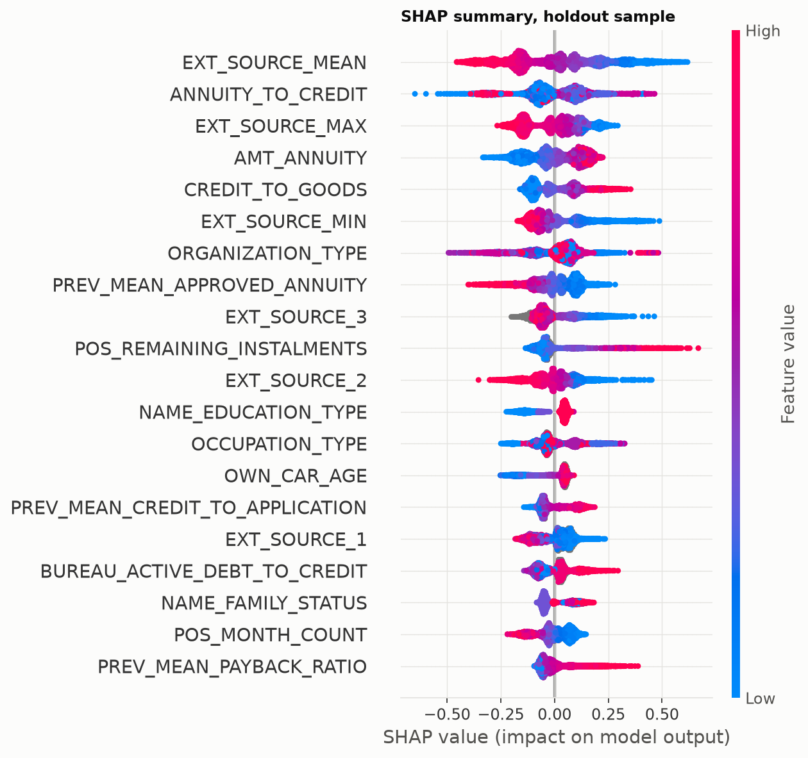
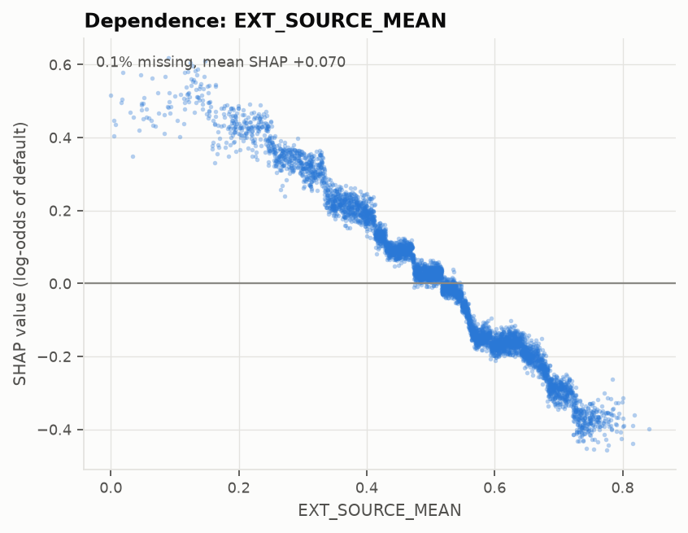
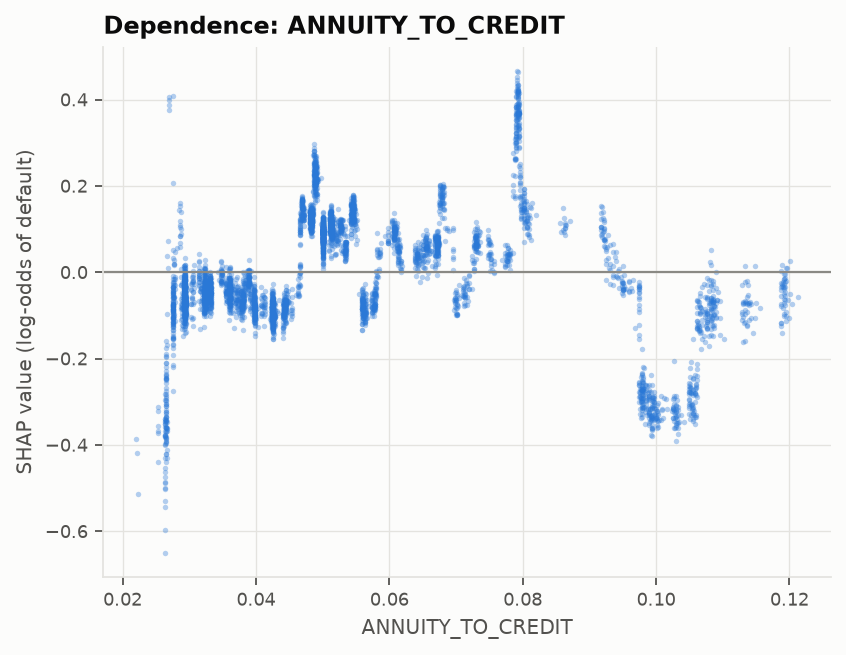
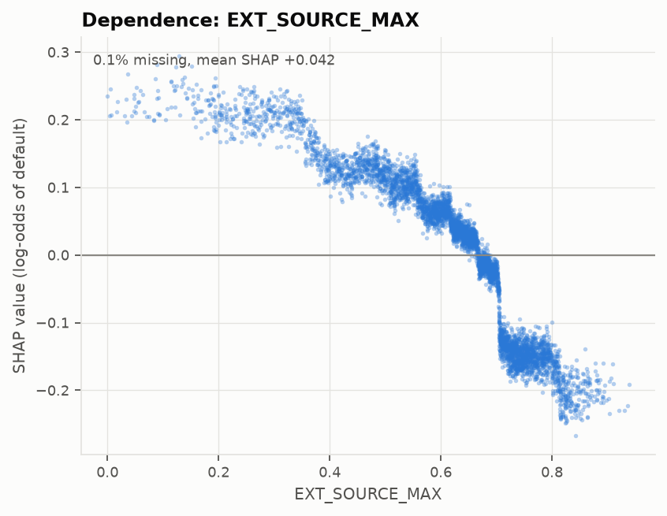
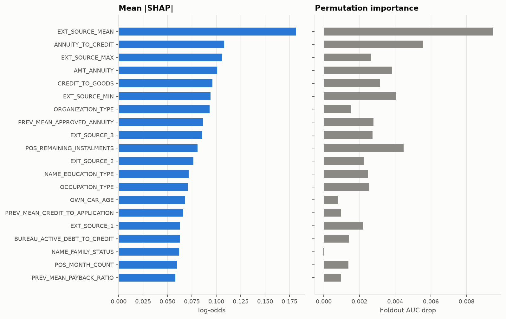

# Explainability and stability

Model: lightgbm, an average of 5 fold models. SHAP values come from TreeExplainer on each fold model and are averaged (averaging is exact because the ensemble averages log-odds). SHAP sample: 5,000 holdout rows.

## Dependence plots for the top 3 features

## SHAP stability across CV folds

Spearman rank correlation of mean absolute SHAP between each pair of fold models: mean 0.9605, minimum 0.9552. Pairwise values: 0.955, 0.959, 0.960, 0.961, 0.962, 0.960, 0.958, 0.965, 0.964, 0.961. Mean overlap of the top 20 features between folds: 0.94.

## SHAP versus permutation importance

Permutation importance is the drop in holdout ROC-AUC when one feature is shuffled (10,000 holdout rows, 3 repeats). A feature is flagged when it is in the top 20 of either ranking and the ranks differ by more than 10 places, or when shuffling it does not reduce AUC.

| SHAP rank | feature | mean abs SHAP | permutation rank | AUC drop | flagged |
|---|---|---|---|---|---|
| 1 | EXT_SOURCE_MEAN | 0.1816 | 1 | 0.00946 |  |
| 2 | ANNUITY_TO_CREDIT | 0.1082 | 2 | 0.00558 |  |
| 3 | EXT_SOURCE_MAX | 0.1057 | 9 | 0.00267 |  |
| 4 | AMT_ANNUITY | 0.1010 | 5 | 0.00384 |  |
| 5 | CREDIT_TO_GOODS | 0.0960 | 6 | 0.00314 |  |
| 6 | EXT_SOURCE_MIN | 0.0941 | 4 | 0.00405 |  |
| 7 | ORGANIZATION_TYPE | 0.0932 | 18 | 0.00151 | yes |
| 8 | PREV_MEAN_APPROVED_ANNUITY | 0.0864 | 7 | 0.00278 |  |
| 9 | EXT_SOURCE_3 | 0.0853 | 8 | 0.00273 |  |
| 10 | POS_REMAINING_INSTALMENTS | 0.0807 | 3 | 0.00447 |  |
| 11 | EXT_SOURCE_2 | 0.0764 | 12 | 0.00226 |  |
| 12 | NAME_EDUCATION_TYPE | 0.0716 | 11 | 0.00249 |  |
| 13 | OCCUPATION_TYPE | 0.0706 | 10 | 0.00256 |  |
| 14 | OWN_CAR_AGE | 0.0681 | 30 | 0.00082 | yes |
| 15 | PREV_MEAN_CREDIT_TO_APPLICATION | 0.0657 | 28 | 0.00096 | yes |
| 16 | EXT_SOURCE_1 | 0.0630 | 13 | 0.00222 |  |
| 17 | BUREAU_ACTIVE_DEBT_TO_CREDIT | 0.0625 | 19 | 0.00142 |  |
| 18 | NAME_FAMILY_STATUS | 0.0619 | 224 | -0.00002 | yes |
| 19 | POS_MONTH_COUNT | 0.0597 | 21 | 0.00138 |  |
| 20 | PREV_MEAN_PAYBACK_RATIO | 0.0582 | 27 | 0.00097 |  |

### Flagged disagreements

| feature | SHAP rank | permutation rank | AUC drop |
|---|---|---|---|
| ORGANIZATION_TYPE | 7 | 18 | 0.00151 |
| OWN_CAR_AGE | 14 | 30 | 0.00082 |
| PREV_MEAN_CREDIT_TO_APPLICATION | 15 | 28 | 0.00096 |
| NAME_FAMILY_STATUS | 18 | 224 | -0.00002 |
| PREV_MEAN_TERM | 26 | 15 | 0.00177 |
| DAYS_BIRTH | 27 | 16 | 0.00156 |

Disagreements usually come from correlated features: SHAP splits credit among correlated inputs while permuting one of them leaves the others to carry the signal.

## Population stability index

Reference: training split (the score uses out-of-fold predictions). Comparison: holdout. Thresholds: below 0.1 stable, 0.1 to 0.25 moderate shift, above 0.25 significant shift. The holdout is a random split of the same population, so low values are expected; this table is the template for monitoring later vintages.

| variable | PSI | status |
|---|---|---|
| model score | 0.00049 | stable |
| EXT_SOURCE_MEAN | 0.00017 | stable |
| ANNUITY_TO_CREDIT | 0.00026 | stable |
| EXT_SOURCE_MAX | 0.00031 | stable |
| AMT_ANNUITY | 0.00028 | stable |
| CREDIT_TO_GOODS | 0.00014 | stable |
| EXT_SOURCE_MIN | 0.00020 | stable |
| ORGANIZATION_TYPE | 0.00080 | stable |
| PREV_MEAN_APPROVED_ANNUITY | 0.00014 | stable |
| EXT_SOURCE_3 | 0.00039 | stable |
| POS_REMAINING_INSTALMENTS | 0.00008 | stable |
| EXT_SOURCE_2 | 0.00012 | stable |
| NAME_EDUCATION_TYPE | 0.00013 | stable |
| OCCUPATION_TYPE | 0.00036 | stable |
| OWN_CAR_AGE | 0.00028 | stable |
| PREV_MEAN_CREDIT_TO_APPLICATION | 0.00020 | stable |
| EXT_SOURCE_1 | 0.00073 | stable |
| BUREAU_ACTIVE_DEBT_TO_CREDIT | 0.00020 | stable |
| NAME_FAMILY_STATUS | 0.00003 | stable |
| POS_MONTH_COUNT | 0.00021 | stable |
| PREV_MEAN_PAYBACK_RATIO | 0.00013 | stable |
