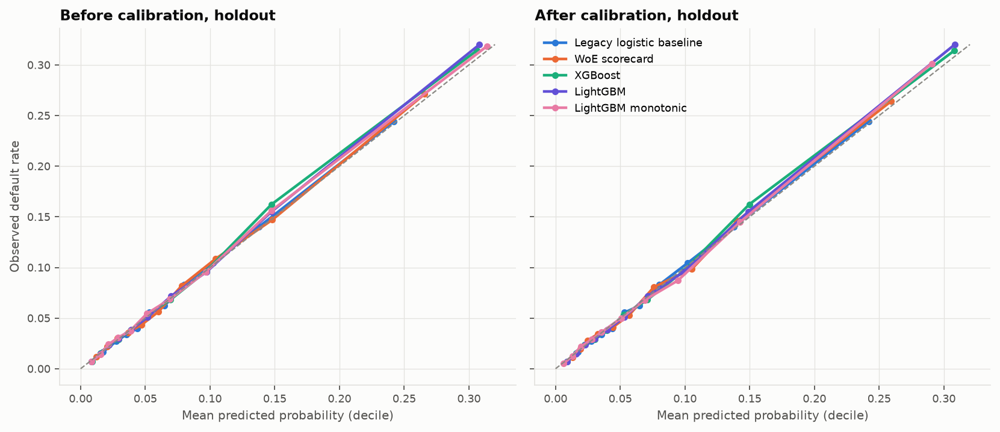
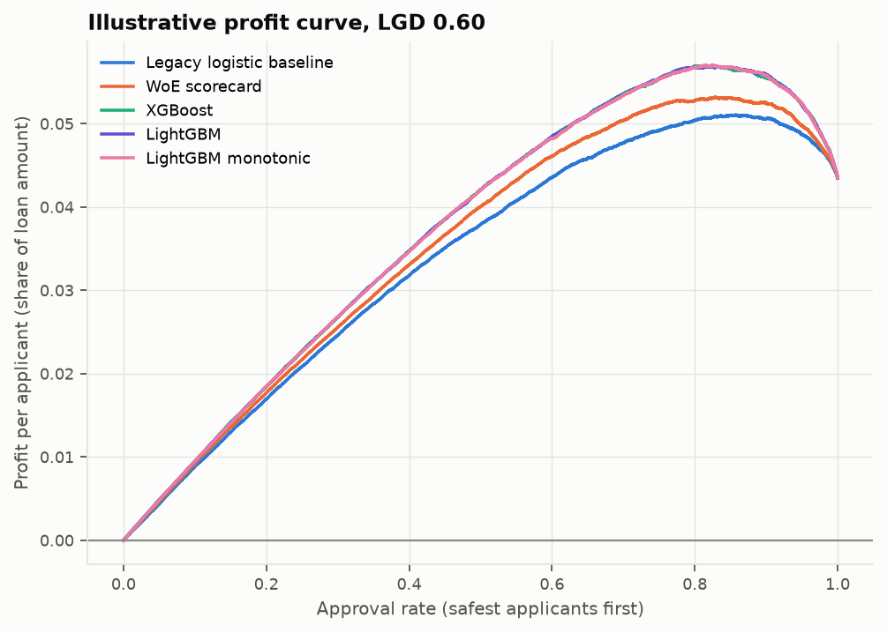
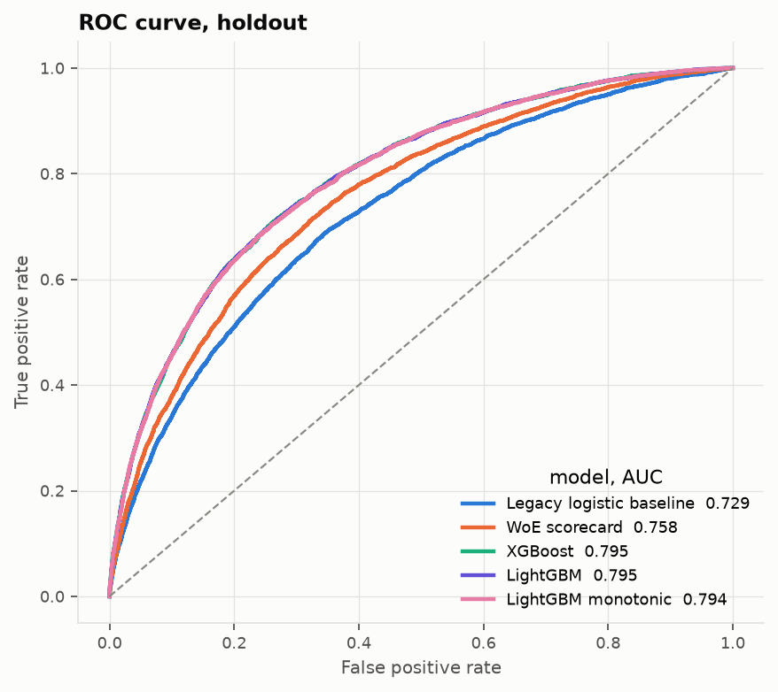
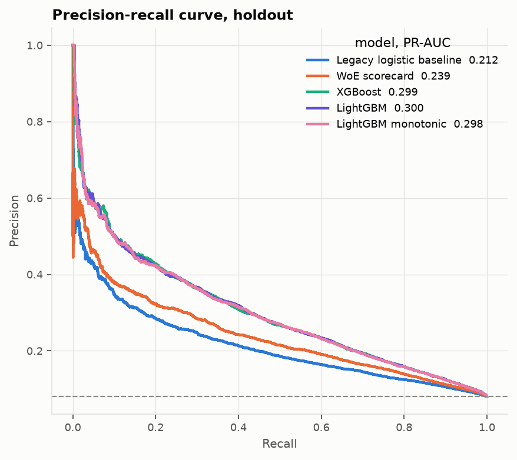
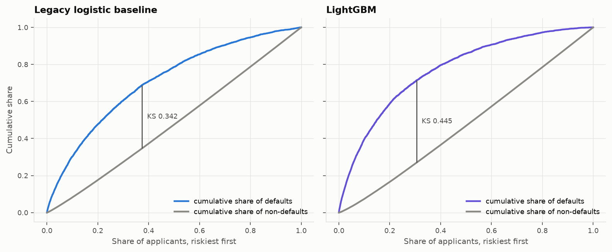

# Model comparison

Holdout set: 61,503 applications, observed default rate 0.0807. The holdout was split off once before any modeling and never used for tuning, feature selection or calibration fitting. Confidence intervals come from 1000 paired bootstrap resamples (same indices for every model).

Ranking metrics (ROC-AUC, PR-AUC, KS, Gini) use the raw model score. Probability metrics (Brier, log loss, ECE) use the calibrated probability.

## Holdout metrics

| model | ROC-AUC [95% CI] | PR-AUC | KS [95% CI] | Gini | Brier | log loss | ECE | calibration |
|---|---|---|---|---|---|---|---|---|
| Legacy logistic baseline | 0.7288 [0.7209, 0.7364] | 0.2120 | 0.3421 [0.3286, 0.3573] | 0.4575 | 0.06939 | 0.2540 | 0.0022 | platt |
| WoE scorecard | 0.7581 [0.7504, 0.7656] | 0.2388 | 0.3896 [0.3773, 0.4054] | 0.5162 | 0.06799 | 0.2465 | 0.0037 | isotonic |
| XGBoost | 0.7947 [0.7880, 0.8012] | 0.2993 | 0.4465 [0.4349, 0.4608] | 0.5894 | 0.06503 | 0.2337 | 0.0032 | platt |
| LightGBM | 0.7946 [0.7880, 0.8011] | 0.2996 | 0.4449 [0.4339, 0.4589] | 0.5891 | 0.06504 | 0.2338 | 0.0030 | platt |
| LightGBM monotonic | 0.7940 [0.7873, 0.8006] | 0.2984 | 0.4437 [0.4320, 0.4575] | 0.5880 | 0.06508 | 0.2340 | 0.0030 | isotonic |

## AUC difference versus the legacy baseline

| model | AUC difference | 95% CI | share of resamples at or below zero |
|---|---|---|---|
| WoE scorecard | +0.0293 | [+0.0252, +0.0336] | 0.000 |
| XGBoost | +0.0660 | [+0.0608, +0.0709] | 0.000 |
| LightGBM | +0.0659 | [+0.0606, +0.0708] | 0.000 |
| LightGBM monotonic | +0.0653 | [+0.0601, +0.0700] | 0.000 |

## Calibration

Calibrator chosen per model by cross-validated Brier score on out-of-fold training predictions. ECE uses 10 equal-frequency bins.

| model | method | Brier before | Brier after | ECE before | ECE after | mean predicted after |
|---|---|---|---|---|---|---|
| Legacy logistic baseline | platt | 0.06939 | 0.06939 | 0.0022 | 0.0022 | 0.0805 |
| WoE scorecard | isotonic | 0.06796 | 0.06799 | 0.0027 | 0.0037 | 0.0801 |
| XGBoost | platt | 0.06504 | 0.06503 | 0.0032 | 0.0032 | 0.0799 |
| LightGBM | platt | 0.06504 | 0.06504 | 0.0029 | 0.0030 | 0.0799 |
| LightGBM monotonic | isotonic | 0.06510 | 0.06508 | 0.0025 | 0.0030 | 0.0800 |

## Approval rate at a fixed bad rate

Applicants are approved from lowest to highest predicted risk until the bad rate among approved applicants reaches the target.

| model | bad rate 3.0% | bad rate 5.0% | bad rate 8.0% |
|---|---|---|---|
| Legacy logistic baseline | 41.9% | 76.3% | 99.8% |
| WoE scorecard | 53.3% | 81.4% | 99.9% |
| XGBoost | 63.7% | 86.8% | 99.9% |
| LightGBM | 63.9% | 86.9% | 99.9% |
| LightGBM monotonic | 64.0% | 86.8% | 99.9% |

## Illustrative cost analysis

**These figures use illustrative assumptions, not data.** Profit per approved good loan is the margin, loss per approved bad loan is the loss given default, both as a share of the loan amount. The break-even PD policy approves applicants whose calibrated PD is below margin / (margin + LGD).

Loss given default 0.30, margin 0.10, cost ratio 3.0, break-even PD 0.2500

| model | best profit per applicant | approval at best cut-off | profit with break-even PD policy | approval under policy |
|---|---|---|---|---|
| Legacy logistic baseline | 0.06871 | 96.0% | 0.06866 | 96.7% |
| WoE scorecard | 0.06928 | 93.4% | 0.06918 | 95.5% |
| XGBoost | 0.07078 | 94.0% | 0.07075 | 93.9% |
| LightGBM | 0.07082 | 93.3% | 0.07073 | 94.0% |
| LightGBM monotonic | 0.07077 | 93.5% | 0.07073 | 93.8% |

Loss given default 0.60, margin 0.10, cost ratio 6.0, break-even PD 0.1429

| model | best profit per applicant | approval at best cut-off | profit with break-even PD policy | approval under policy |
|---|---|---|---|---|
| Legacy logistic baseline | 0.05105 | 85.1% | 0.05090 | 86.3% |
| WoE scorecard | 0.05318 | 82.9% | 0.05299 | 85.6% |
| XGBoost | 0.05692 | 80.4% | 0.05668 | 84.4% |
| LightGBM | 0.05688 | 82.5% | 0.05672 | 84.5% |
| LightGBM monotonic | 0.05702 | 82.6% | 0.05697 | 82.7% |

Loss given default 0.90, margin 0.10, cost ratio 9.0, break-even PD 0.1000

| model | best profit per applicant | approval at best cut-off | profit with break-even PD policy | approval under policy |
|---|---|---|---|---|
| Legacy logistic baseline | 0.03838 | 73.7% | 0.03819 | 74.3% |
| WoE scorecard | 0.04246 | 74.0% | 0.04215 | 71.1% |
| XGBoost | 0.04739 | 78.0% | 0.04708 | 75.6% |
| LightGBM | 0.04738 | 77.5% | 0.04723 | 75.6% |
| LightGBM monotonic | 0.04715 | 77.0% | 0.04704 | 76.4% |

## Curves

